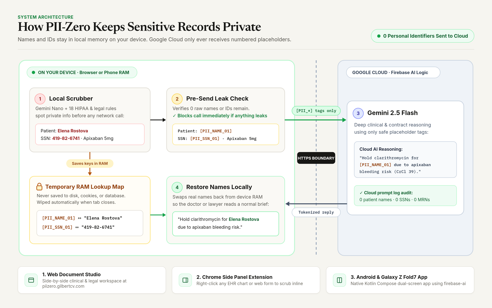
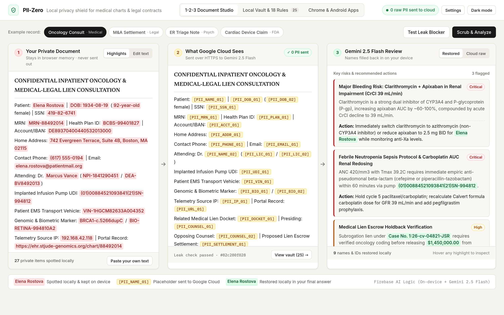
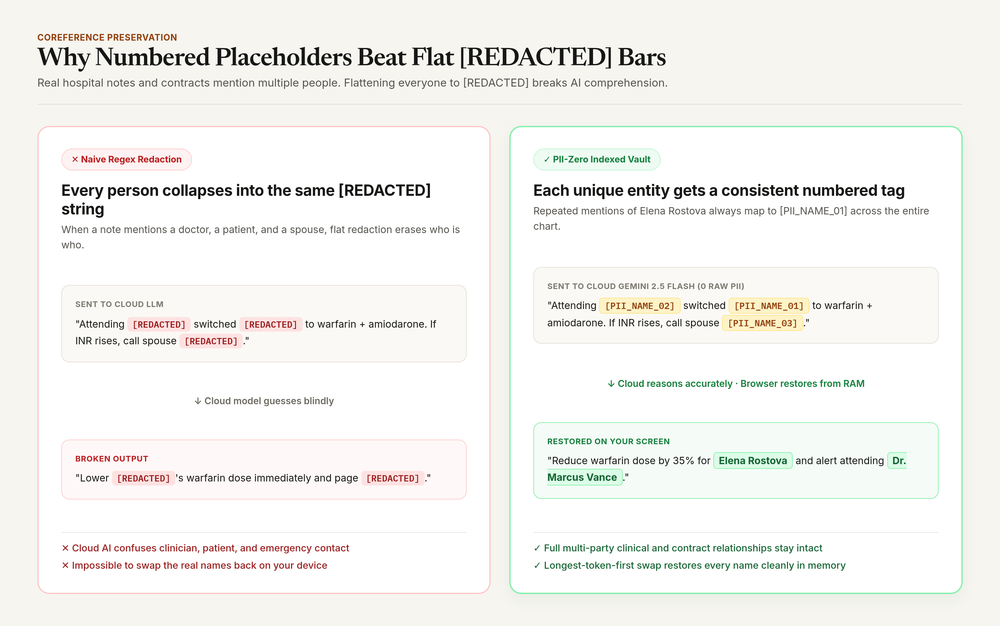
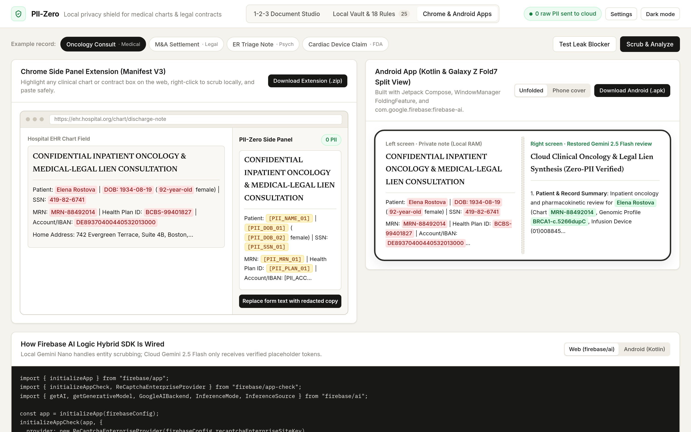

# PII-Zero: Local Privacy Shield for Medical & Legal AI

**Live Document Studio:** [https://piizero.gilbertcv.com](https://piizero.gilbertcv.com)  
**Companion Downloads:** [Chrome Side Panel Extension (`.zip`)](https://piizero.gilbertcv.com/downloads/piizero-chrome-extension.zip) · [Android Foldable App (`.apk`)](https://piizero.gilbertcv.com/downloads/piizero-android-debug.apk)



PII-Zero lets clinicians and attorneys analyze sensitive medical charts and legal contracts with **Cloud Gemini 2.5 Flash** without ever sending a patient or client's real identity across the network. Built on the **Firebase AI Logic Hybrid SDK** (`firebase/ai` on Web/Chrome and `com.google.firebase:firebase-ai` on Android), it scrubs personal identifiers locally on the device first, verifies zero leaks before sending, and restores the real names on your screen when the answer comes back.



---

## How it works

1. **Local Scrubbing (`InferenceMode.ONLY_ON_DEVICE` / `PREFER_ON_DEVICE`):**  
   Scans documents locally in browser or Android RAM using **Gemini Nano** alongside an 18-category HIPAA Safe Harbor and legal privilege scanner. Sensitive names, SSNs, MRNs, and docket numbers are swapped for numbered placeholders (`[PII_NAME_01]`, `[PII_SSN_01]`), while original values stay in an in-memory `Map` (never written to disk, cookies, or `localStorage`).
2. **Pre-Send Leak Blocker:**  
   Re-checks the outgoing text right before any network request opens. If a raw SSN, MRN, or name remains, the request is aborted locally (`0` bytes sent).
3. **Cloud Gemini 2.5 Flash Review (`InferenceMode.ONLY_IN_CLOUD`):**  
   Sends only the safe placeholder text through Firebase AI Logic + App Check to flag drug interactions, renal dosing issues, and contract liability risks.
4. **Local Name Restoration:**  
   Swaps the real names and IDs back into the returned summary on your device (longest tags first so `[PII_NAME_10]` never collides with `[PII_NAME_1]`).



---

## Project structure

```text
.
├── src/
│   ├── engine/
│   │   ├── piiAirlock.ts          # 18-rule HIPAA & legal scrubber, RAM vault, leak check & restorer
│   │   └── firebaseHybridSdk.ts   # Firebase AI Logic Hybrid SDK + App Check + Gemini Nano probe
│   ├── App.tsx                    # 1-2-3 Daylight Document Studio, Vault viewer & App previews
│   └── styles.css                 # Daylight clinical & legal paper styling (+ optional dark mode)
├── server/
│   └── server.mjs                 # Node 22 HTTP server + zero-PII verification endpoint
├── chrome-extension/              # Manifest V3 Chrome Side Panel extension
├── android/                       # Kotlin + Jetpack Compose + Galaxy Z Fold7 dual-screen app
├── docs/images/                   # Visual architecture diagrams & 2x Retina screenshots
└── tests/
    └── airlock.test.ts            # Vitest suite (18 HIPAA categories, leak blocker, SDK, HTTP API)
```



---

## Running & testing locally

### 1. Web Document Studio & Server (Node 22+)
```bash
npm install
npm test          # Runs Vitest suite (7/7 tests)
npm run build     # Type-checks and builds dist/
npm start         # Serves on http://localhost:8764
```

### 2. Chrome Side Panel Extension (Manifest V3)
```bash
cd chrome-extension
npm install
npm test          # Runs Node test suite (4/4 tests)
npm run build     # Bundles dist/ and extension icons
```
Load `chrome-extension/dist` via `chrome://extensions` -> **Developer mode** -> **Load unpacked**.

### 3. Android App (Kotlin + Jetpack Compose)
```bash
cd android
./gradlew testDebugUnitTest assembleDebug
```

## License

MIT
