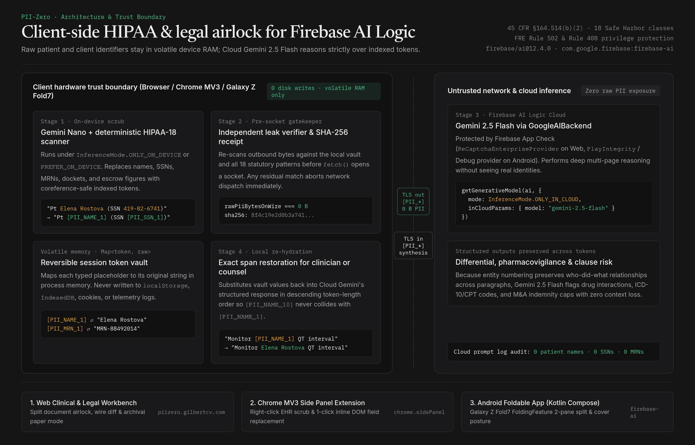
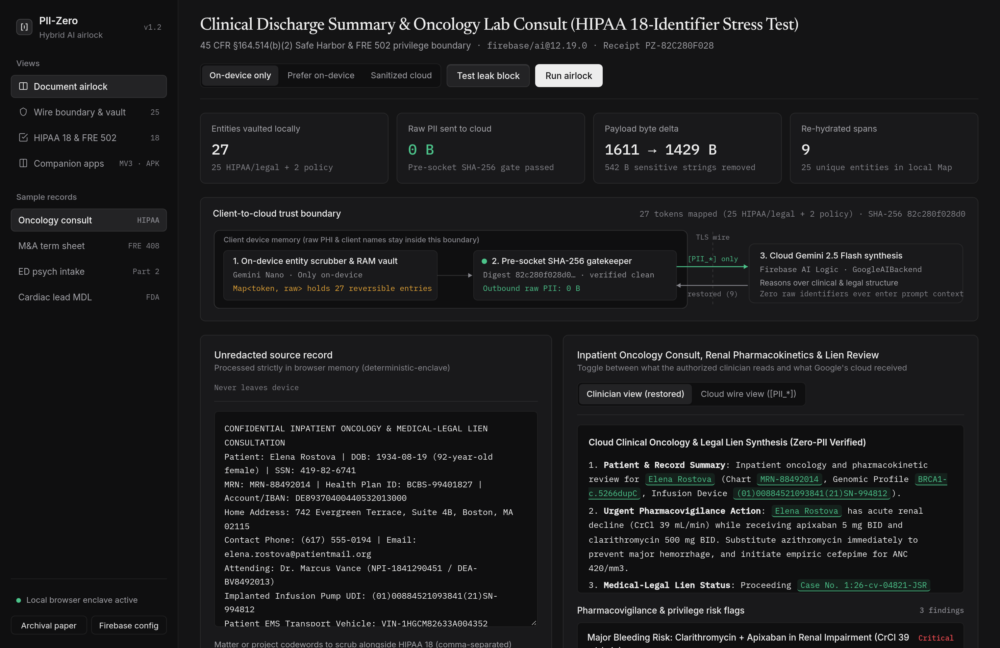
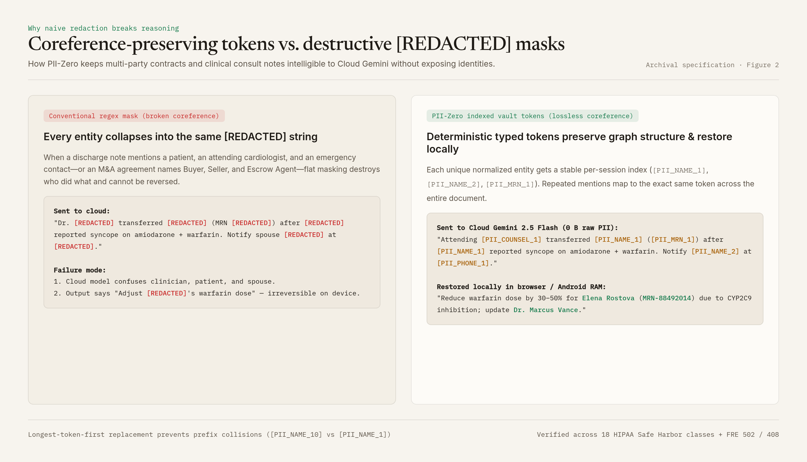
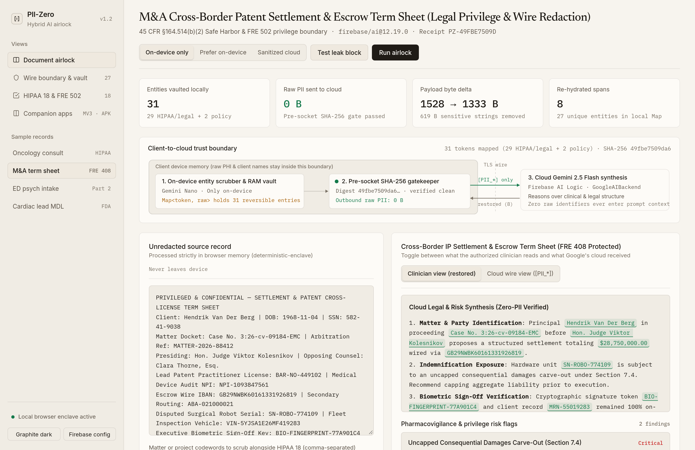

# PII-Zero — Clinical & Legal Hybrid AI Airlock

**Live Workbench:** [https://piizero.gilbertcv.com](https://piizero.gilbertcv.com)  
**Companion Downloads:** [Chrome MV3 Extension (`.zip`)](https://piizero.gilbertcv.com/downloads/piizero-chrome-extension.zip) · [Android Foldable App (`.apk`)](https://piizero.gilbertcv.com/downloads/piizero-android-debug.apk)



PII-Zero is a client-side privacy airlock built with the **Firebase AI Logic Hybrid SDK** (`firebase/ai` on Web/Chrome and `com.google.firebase:firebase-ai` on Android). It lets clinicians and attorneys run deep **Cloud Gemini 2.5 Flash** analysis on discharge summaries, pharmacogenomic consults, and M&A disclosure schedules while guaranteeing that **0 bytes of raw PII/PHI ever cross the network socket**.

---

## How the 4-stage hybrid boundary works

1. **Stage 1 — On-device scrub (`InferenceMode.ONLY_ON_DEVICE` / `PREFER_ON_DEVICE`):**  
   Scans source records locally in browser or Android memory using Chrome Built-in AI (**Gemini Nano**) paired with a deterministic 18-identifier **HIPAA Safe Harbor** (`45 CFR §164.514(b)(2)`) and **FRE 502 / 408** privilege scanner. Personal identifiers are replaced with entity-indexed placeholders (`[PII_NAME_01]`, `[PII_SSN_01]`, `[PII_MRN_01]`, `[PII_DOCKET_01]`), while raw values stay inside an ephemeral in-memory `Map` (zero disk, cookie, or `localStorage` writes).
2. **Stage 2 — Pre-socket SHA-256 gatekeeper:**  
   Re-verifies the outbound string before `fetch()` or `GoogleAIBackend` opens a connection. Any residual raw identifier hard-blocks network dispatch and raises a local leak alert.
3. **Stage 3 — Cloud Gemini 2.5 Flash synthesis (`InferenceMode.ONLY_IN_CLOUD`):**  
   Sends only the tokenized structure through Firebase AI Logic + App Check to generate pharmacovigilance alerts, ICD-10-CM / CPT / statutory schedules, and clause risk summaries.
4. **Stage 4 — Local token restoration:**  
   Substitutes real names and record numbers back into the cloud response on the client device (longest-token-first to prevent prefix collisions).





---

## Repository structure

```text
.
├── src/
│   ├── engine/
│   │   ├── piiAirlock.ts          # 18-class HIPAA + FRE 502 scrubber, vault, leak verifier & re-hydrator
│   │   └── firebaseHybridSdk.ts   # Official firebase/ai HybridParams, App Check & Gemini Nano probe
│   ├── components/
│   │   └── AirlockPipelineSvg.tsx # Client-to-cloud trust boundary schematic
│   ├── App.tsx                    # 4-view Graphite & Archival Paper workbench
│   └── styles.css                 # Restrained Graphite & Archival Paper design tokens
├── server/
│   └── server.mjs                 # Zero-dependency Node 22 HTTP server + zero-PII receipt verifier
├── chrome-extension/              # Manifest V3 Chrome Side Panel + inline DOM scrubber
├── android/                       # Kotlin + Jetpack Compose + FoldingFeature (Galaxy Z Fold7) app
├── docs/images/                   # Architecture diagrams & 2x Retina product screenshots
└── tests/
    └── airlock.test.ts            # End-to-end Vitest suite (HIPAA-18, leak gate, SDK, HTTP API)
```



---

## Quick start & verification

### 1. Web Workbench & API Server (Node 22+)
```bash
npm install
npm test          # Runs Vitest suite across all 18 HIPAA categories & 4 presets
npm run build     # Type-checks & builds production bundle into dist/
npm start         # Starts server on http://localhost:8764
```

### 2. Chrome Manifest V3 Side Panel Extension
```bash
cd chrome-extension
npm install
npm test          # Runs Node test runner (4/4 airlock & gatekeeper checks)
npm run build     # Bundles dist/ via esbuild + generates icons
```
Load `chrome-extension/dist` via `chrome://extensions` → **Developer mode** → **Load unpacked** (or download `piizero-chrome-extension.zip` from the live app).

### 3. Android Foldable App (Kotlin + Jetpack Compose)
```bash
cd android
./gradlew testDebugUnitTest assembleDebug
```
Outputs `app/build/outputs/apk/debug/app-debug.apk` with `com.google.firebase:firebase-ai` and `androidx.window.layout.FoldingFeature` dual-pane posture support.

## License

MIT
